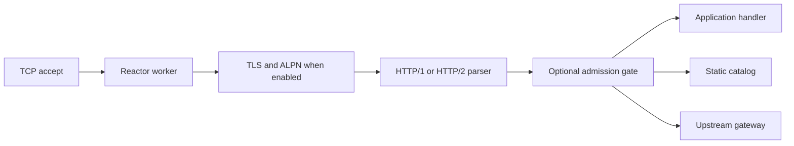

# lean-net

Lean 4 libraries for TCP, HTTP/1.0, HTTP/1.1, HTTP/2, and WebSocket servers. The optional [`lean-net-tls`](tls/README.md) package adds TLS, mTLS, SNI, and ALPN. Both packages use the same HTTP handlers and native reactor on Linux, macOS, and Windows.

[API reference](https://isavita.github.io/lean-net/).

[Runnable servers](examples/README.md): basic HTTP, a routed API, TLS static files, and a rate-limited gateway.

## Install

Use the Lean version in [`lean-toolchain`](lean-toolchain). Install `pkg-config`, zlib, and Brotli development libraries (`zlib`, `libbrotlienc`, `libbrotlicommon`); Windows builds also need MinGW GCC and matching import libraries. In a consumer `lakefile.lean`:

```lean
require «lean-net» from git "https://github.com/isavita/lean-net" @ "v0.1.1"
```

For macOS with Homebrew zlib, set `PKG_CONFIG_PATH="$(brew --prefix zlib)/lib/pkgconfig${PKG_CONFIG_PATH:+:$PKG_CONFIG_PATH}"` before building. The TLS package also needs OpenSSL 1.1.1 or newer; see [TLS setup](tls/README.md).

## Use

```lean
import LeanNet

open LeanNet

def main : IO Unit :=
  HTTP.ReactorServer.serveFactory
    (fun _ => pure {
      onRequest := fun _ =>
        pure { response := { status := 200, body := "ok\n".toUTF8 } }
    })
    { workers := 0, server := { maxClients := 128 } }
    "127.0.0.1" 8080
```

`serveFactory` creates handlers once per worker. Set `workers := 0` for the available CPU count; callbacks run on their owning worker and should not block. `serveWithHandlers` and `serveWithConfig` are single-worker entry points. `LeanNet.withListener` and `LeanNet.withConnection` provide bracketed socket ownership for lower-level applications.



## Features and configuration

| Feature | Library configuration | Guide |
| --- | --- | --- |
| HTTP/1.x, HTTP/2, h2c, keep-alive, WebSocket | `HTTP.ReactorServerConfig`, `HTTP1.Handlers`; HTTP/2 uses `http2`, `h2cUpgrade` | [Server options](docs/server.md) |
| TLS, mTLS, SNI, certificate reload | `LeanNetTLS.Reactor.Config` and `LeanNetTLS.ReactorServer.serveFactory` | [TLS](tls/README.md) |
| Static files, compression, ranges, validators | `HTTP.Static.serveRoot` and `HTTP.Static.Catalog.Config` | [Static files](docs/static-files.md) |
| Host routing, validation, rate limits, reverse proxy | `Gate.Spec`, `Gate.factory`, `ReactorServerConfig.admission` and `gateway` | [Gate and gateway](docs/gateway.md) |
| Metrics, access logs, health, tracing, graceful drain | `HTTP.ReactorServerConfig` | [Server options](docs/server.md) |
| Benchmarks | Reproducible commands and results | [Benchmarks](docs/benchmarks.md) |

The default listener is `127.0.0.1`; pass an explicit bind address to expose it. One listener serves HTTP/1 and HTTP/2 clients using the same handlers. Configure HTTP/1 through `machine` and HTTP/2 through `http2`; protocol selection uses the cleartext preface or h2c upgrade, and ALPN on TLS. See [combined protocol configuration](docs/server.md). The gateway forwards to HTTP/1.1 backends over HTTP or verified HTTPS.

## Build and test

```sh
lake build
lake -d tls build lean-net-tls
python3 test/soak.py --count 10000
```

Run the focused suites in [test/README.md](test/README.md). The executable entry points `lean-net-http1` and `lean-net-tls` use the same library APIs; their flags are listed in the [server](docs/server.md) and [TLS](tls/README.md) guides.

Generate the API reference with `lake -d docs build LeanNetDocs:docs`. Serve `docs/.lake/build/doc` over HTTP to browse it locally.

## License

[Apache-2.0](LICENSE).
